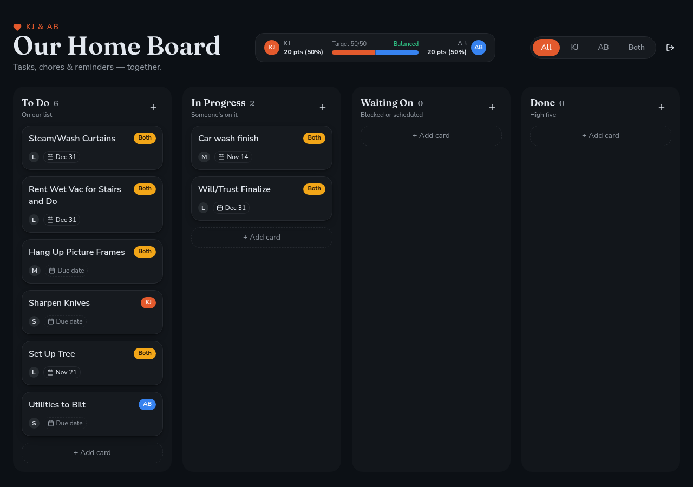
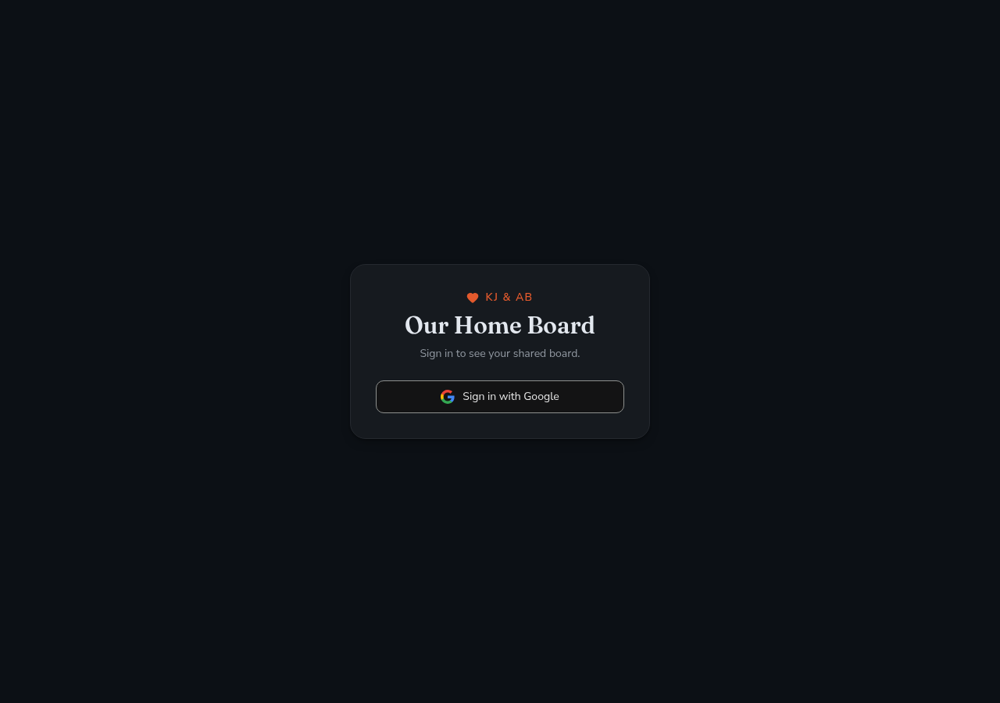
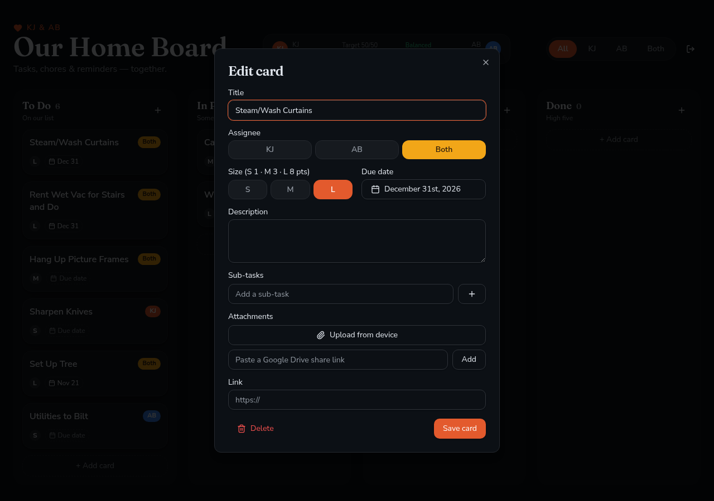

# Our Home Board — ABKJ Marriage Collab

A shared kanban board for two people running a household together: tasks, chores, and reminders with a built-in **effort-balance bar** that keeps the load fair between partners.

**Live app:** https://kjab-collab.lovable.app



## What it does

- **Four-column kanban** (To Do → In Progress → Waiting On → Done) with drag-and-drop, all visible in one row.
- **50/50 balance bar** — every card carries effort points by size (S = 1, M = 3, L = 8), and the header shows each partner's share of the total load at a glance. "Both" cards split points evenly.
- **Rich cards** — assignee (KJ / AB / Both), size, due date with an inline calendar picker on every card, description, link, **sub-task checklists**, and **attachments** (device uploads or Google Drive links).
- **Private by design** — Google sign-in; the first two accounts to sign in become the board's only members, enforced by row-level security in the database.
- **Real-time sync** — both partners see each other's changes live, on any device.

| Sign-in | Card editing |
| --- | --- |
|  |  |

## Tech stack

- **Frontend:** React 19, TypeScript, TanStack Start (SSR) + TanStack Router/Query, Vite 7
- **Styling:** Tailwind CSS v4 with semantic design tokens, shadcn/ui, Fraunces + Nunito Sans
- **Backend (Lovable Cloud / Supabase):** Postgres with row-level security, Google OAuth, realtime subscriptions, private storage bucket for attachments
- **Testing:** Vitest + Testing Library

## How it's built

- `src/routes/index.tsx` — the board UI (columns, cards, drag-and-drop, balance bar, card dialog)
- `src/lib/board.ts` — board math and card types (point values, balance calculation), unit-tested in `src/test/balance.test.ts`
- Database access is gated by a `board_members` table: a trigger records the first two sign-ins as members, and every card/attachment policy checks membership — no hardcoded emails.

## Running locally

```sh
git clone <this-repository-url>
cd <repository-name>
npm i
npm run dev
```

---

Built with [Lovable](https://lovable.dev) · [Continue in the Lovable editor](https://lovable.dev/projects/47552ae3-f4c2-4a7a-ac8a-b3b17902185c)
